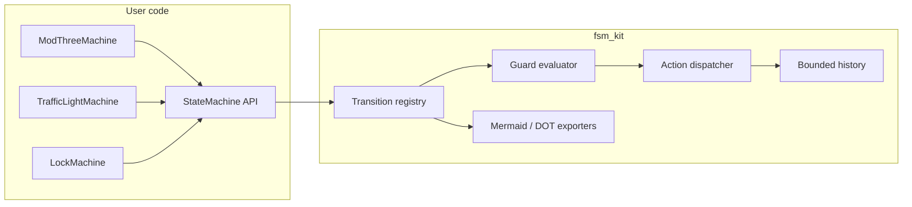

# Architecture

## Context

`class_fsm` contains three layers:

1. **Original implementations** (`finite_state_machine/`, `binary_classification_threshold/`) — focused, self-contained solutions kept for provenance.
2. **`fsm_kit`** — a reusable engine that generalises the FSM idea.
3. **Test/CI layer** — exhaustive behavioural tests and a coverage gate.



## Core model

### `Transition`

Frozen dataclass with `source`, `event`, `target`, optional `guard`, optional `action`.
Validation rejects empty state/event names at construction.

### `StateMachine`

Owns:

- `_states`: set of known states (initial state auto-registered)
- `_events`: set of known events
- `_transitions`: dict keyed by `(source, event)` — guarantees determinism
- `_history`: `deque(maxlen=N)` of `TransitionRecord`

### Transition protocol

```text
trigger(event, context)
  ├─ reject unknown event          → UnknownEventError
  ├─ reject missing edge           → InvalidTransitionError
  ├─ evaluate guard (if any)       → reject on false
  ├─ build immutable record
  ├─ run action (if any)           → exception propagates, state unchanged
  ├─ mutate state
  └─ append record to history
```

The ordering is deliberate: **action success is a precondition for state mutation**.

## Invariants

| Invariant | Enforcement |
|---|---|
| One edge per `(state, event)` | `add_transition` raises `ValueError` on duplicates |
| Initial state is known | constructor registers it |
| Names are non-empty strings | `Transition.__post_init__` + constructor checks |
| History never exceeds the limit | `deque(maxlen=history_limit)` |
| Exports are deterministic | transitions iterated in sorted key order |
| No third-party runtime deps | stdlib imports only |

## Extension points

- **New machines:** subclass `StateMachine` and register transitions in `__init__`.
- **Context-rich guards:** pass any `Mapping[str, Any]` to `trigger`.
- **Effects:** use actions for logging, metrics, or event-bus publication.
- **Persistence:** `TransitionRecord.as_dict()` is JSON-ready; replay by feeding the event sequence.
- **Observability:** wrap `trigger` or subscribe to the returned record.

## Failure semantics

| Condition | Exception | State after |
|---|---|---|
| Unknown event | `UnknownEventError` | unchanged |
| No edge from current state | `InvalidTransitionError` | unchanged |
| Guard returns false | `InvalidTransitionError` | unchanged |
| Action raises | original exception | unchanged |
| Duplicate edge | `ValueError` | machine not modified |

## Testing architecture

- `tests/test_fsm_kit.py` covers model construction, runtime protocol, exports, all bundled machines, and the CLI.
- Exhaustive parametrisation (`range(512)`) cross-checks modulo-3 against Python's `%`.
- `--cov-fail-under=100` prevents coverage regressions.
- CI runs the suite on Python 3.10, 3.11, and 3.12.

See [TESTING.md](./TESTING.md) for commands and evidence.
