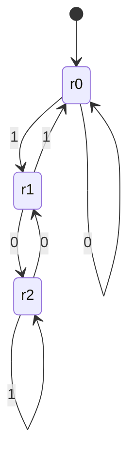

# class_fsm — Finite-State Machines, Engineered Like Production Software

**A dependency-free Python toolkit for deterministic state machines: typed transitions, guards with context, audit history, and one-line Mermaid/Graphviz exports — backed by 588 passing tests and 100% branch coverage.**

[](https://github.com/MrKyaw/class_fsm/actions/workflows/ci.yml)
[](https://www.python.org/)
[](./TESTING.md)
[](./TESTING.md)
[](./license.txt)

---

## Why this repository exists

State machines are everywhere — protocols, order lifecycles, device controllers, agent workflows, UI flows. Most implementations start as a `switch` statement and become an unmaintainable tangle of implicit transitions.

This repository shows the opposite approach:

| Principle | What you get |
|---|---|
| **Validated at build time** | Empty states, duplicate `(state, event)` pairs, and non-callable guards fail immediately. |
| **Observable at runtime** | Every successful trigger returns an immutable `TransitionRecord` with its context. |
| **Safe by construction** | Guards run before mutation; a failing action cannot leave a half-transitioned machine. |
| **Documentation that cannot drift** | Mermaid and Graphviz diagrams are generated from the same graph that executes. |
| **Provable behaviour** | Exhaustive tests compare the modulo-3 automaton against Python's `%` for every value from 0–511. |

The repo keeps two original, self-contained implementations and adds a general-purpose engine (`fsm_kit`) that formalises the ideas behind them.

---

## What's inside

```
class_fsm/
├── fsm_kit/                          # ⭐ new reusable engine (Python 3.10+, stdlib only)
│   ├── core.py                       # StateMachine, Transition, guards, actions, history, exports
│   ├── machines.py                   # ModThreeMachine, TrafficLightMachine, LockMachine
│   └── __main__.py                   # CLI: python -m fsm_kit 1101
├── tests/test_fsm_kit.py             # 580+ parametrised tests, 100% branch coverage
├── binary_classification_threshold/  # original: precision/recall threshold optimiser
├── finite_state_machine/             # original: modulo-3 FSM implementation
├── ARCHITECTURE.md                   # design, invariants and extension points
├── TESTING.md                        # how to run and what is verified
├── ABOUT.md                          # project narrative and keyword tags
└── .github/workflows/ci.yml          # Python 3.10–3.12 matrix + coverage gate
```

---

## 60-second quickstart

```bash
git clone https://github.com/MrKyaw/class_fsm.git
cd class_fsm
python -m pip install -e ".[dev]"

# CLI
python -m fsm_kit 1101        # 1  (13 % 3)
python -m fsm_kit --mermaid   # diagram generated from the live machine

# Full suite + coverage gate
pytest --cov=fsm_kit --cov-report=term-missing
```

**Result:**

```text
588 passed, 17 subtests passed in 0.62s
TOTAL   242 statements   70 branches   100% coverage
```

---

## Usage

### 1. Compute a remainder without big integers

```python
from fsm_kit import ModThreeMachine

fsm = ModThreeMachine()
print(fsm.calculate_remainder("1101"))   # 1
print(fsm.calculate_remainder("1" + "0" * 500))  # streams 501 bits in O(1) space
```

### 2. Model a real workflow with guards

```python
from fsm_kit import StateMachine

order = StateMachine("cart")
order.add_transition("cart", "checkout", "pending_payment")
order.add_transition(
    "pending_payment", "pay", "paid",
    guard=lambda ctx: ctx["amount"] > 0,
    action=lambda record: print("charged", record.context["amount"]),
)
order.add_transition("paid", "ship", "shipped")
order.add_transition("paid", "refund", "refunded")

order.trigger("checkout")
order.trigger("pay", {"amount": 4200})
order.trigger("ship")
assert order.state == "shipped"
print(order.export_mermaid())
```

### 3. Safety-first controller

```python
from fsm_kit import TrafficLightMachine

light = TrafficLightMachine()
light.advance()            # green
light.emergency_stop()     # red — accepted from every state
```

### 4. Diagram as code



Run `python -m fsm_kit --mermaid` or `--dot` to regenerate it directly from the machine.

---

## Test strategy

| Layer | What is verified |
|---|---|
| Construction | Invalid names, non-integer history limits, duplicate transitions, non-callable guards/actions. |
| Runtime | Unknown events, impossible transitions, guard rejection, action failure, history bounds, reset semantics. |
| Exports | Mermaid/DOT escaping, titles, guard/action annotations, deterministic ordering. |
| Machines | Exhaustive 0–511 modulo check, traffic-light cycle, emergency pre-emption, guarded lock. |
| CLI | Arguments, stdin, diagrams, invalid input, `--version`. |

Details and commands: **[TESTING.md](./TESTING.md)**.

---

## Engineering decisions worth discussing in an interview

1. **Guards run before mutation.** The state only changes after the guard passes and the action completes. This eliminates the classic “partially transitioned” bug class.
2. **History is bounded and immutable.** `deque(maxlen=N)` plus frozen dataclasses keep memory predictable and audit records tamper-resistant.
3. **Determinism is enforced, not assumed.** Duplicate `(state, event)` edges are rejected, so behaviour never depends on dict insertion order.
4. **Diagrams are derived, not hand-maintained.** `export_mermaid`/`export_dot` read the live transition table, removing documentation drift.
5. **Zero runtime dependencies.** The engine is stdlib-only; the test toolchain is optional under `[dev]`.

More: **[ARCHITECTURE.md](./ARCHITECTURE.md)** and **[docs/DESIGN_DECISIONS.md](./docs/DESIGN_DECISIONS.md)**.

---

## Recruiter snapshot

- **Role fit:** backend/platform engineer, Python engineer, systems/automation engineer, AI-agent infrastructure.
- **Signals:** rigorous testing (100% branch coverage), API design, deterministic systems, developer tooling, CI/CD, technical writing.
- **Stack:** Python 3.10–3.12, pytest, coverage.py, GitHub Actions, Mermaid, Graphviz DOT.
- **Time to evaluate:** run one command — `pytest --cov=fsm_kit`.

---

## Roadmap

- [ ] Async/thread-safe driver wrapper
- [ ] JSON/YAML machine definitions with schema validation
- [ ] Property-based tests with Hypothesis
- [ ] Publish `fsm-kit` to PyPI

Contributions and design critiques are welcome — see [CONTRIBUTING.md](./CONTRIBUTING.md).

---

## Author

**Kyaw Kyaw Oo** — AI/software engineer focused on reliable agentic systems, evaluation, and developer tooling.
[GitHub](https://github.com/MrKyaw) · [Email](mailto:kyaw.tech@gmail.com)

Licensed under the MIT License. See [license.txt](./license.txt).
